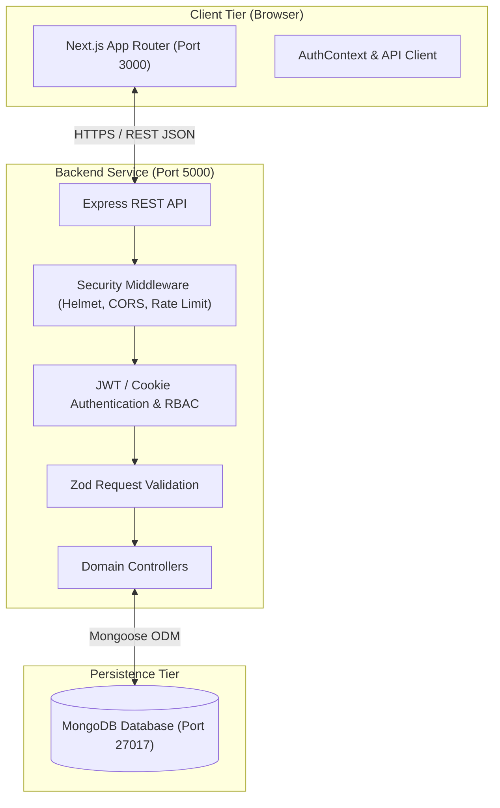
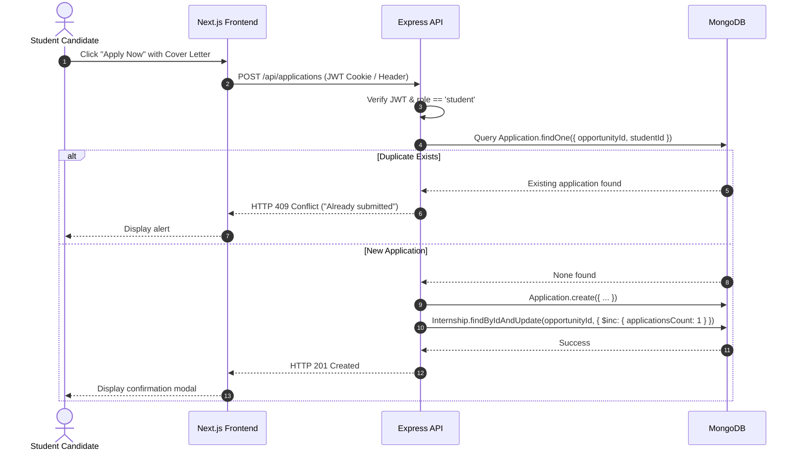

# InternBridge System Architecture

## 1. High-Level Architectural Overview

InternBridge follows a decoupled, three-tier client-server architecture composed of a Next.js (React 18 + TypeScript) frontend, an Express.js (Node.js + TypeScript) RESTful backend API service, and a MongoDB document database managed via Mongoose ODM.

---

## 2. Component Responsibilities

### 2.1 Frontend Tier (`frontend/`)
- **Technology:** Next.js (App Router), React 18, TypeScript, Tailwind CSS, Lucide React.
- **Responsibilities:**
  - Client-side and server-side rendering of pages.
  - Interactive faceted filtering and pagination state management with URL parameter reflection.
  - Form validation, candidate application modals, and bookmarking.
  - Secure credential transport (`credentials: 'include'` for HttpOnly cookies and fallback Bearer tokens).
  - Responsive mobile-first interfaces accessible on mobile, tablet, and desktop viewports.

### 2.2 Backend Service Tier (`backend/`)
- **Technology:** Node.js, Express.js, TypeScript.
- **Responsibilities:**
  - RESTful HTTP routing and semantic status code handling.
  - Security hardening via Helmet headers, origin-locked CORS, and IP rate limiting.
  - Cryptographic operations: Bcrypt password hashing (12 salt rounds) and HMAC-SHA256 JWT generation.
  - Role-Based Access Control (RBAC) protecting Student, Employer, and Admin routes.
  - Request payload validation and sanitization using Zod schemas.
  - Centralized error handling preventing stack trace leakage.

### 2.3 Database Tier (`MongoDB`)
- **Technology:** MongoDB 6.0+ with Mongoose schemas.
- **Responsibilities:**
  - Normalized and referenced document collections (`User`, `StudentProfile`, `EmployerProfile`, `Company`, `Internship`, `Job`, `Application`, `SavedOpportunity`, `ListingReport`, `AuditLog`).
  - Compound indexing ensuring query speed and strict uniqueness (e.g. `[opportunityId, studentId]` preventing duplicate applications).

---

## 3. End-to-End Authentication & Application Sequence

