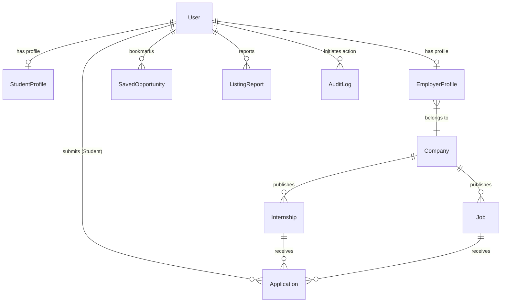

# InternBridge Database Schema Specification

This document details the MongoDB data models, field schemas, indexing strategies, relationships, and integrity constraints implemented via Mongoose.

---

## 1. Entity-Relationship Overview

---

## 2. Collection Specifications

### 2.1 `User`
Stores core authentication and authorization identities.
- `_id`: `ObjectId` (Primary Key)
- `name`: `String` (Required, trim, min 2, max 100)
- `email`: `String` (Required, unique, lowercase, regex-validated)
- `passwordHash`: `String` (Required, select: false)
- `role`: `String` (`'student' | 'employer' | 'admin'`, default: `'student'`)
- `isVerified`: `Boolean` (Default: `false`)
- `avatarUrl`: `String`
- `createdAt`, `updatedAt`: `Date` (Timestamps)
- **Indexes:** `{ email: 1 }` (unique), `{ role: 1 }`

### 2.2 `StudentProfile`
Extended student profile information.
- `userId`: `ObjectId` (Ref: `User`, Required, unique)
- `phone`: `String`
- `headline`: `String` (Max 150)
- `bio`: `String` (Max 1000)
- `location`: `String`
- `skills`: `[String]`
- `education`: Array of `{ institution, degree, fieldOfStudy, startYear, endYear, grade }`
- `experience`: Array of `{ title, company, location, startDate, endDate, isCurrent, description }`
- `resumeUrl`: `String`
- `portfolioWebsite`, `githubUrl`, `linkedinUrl`: `String`
- **Indexes:** `{ userId: 1 }` (unique), `{ skills: 1 }`

### 2.3 `Company`
Verified employer organizations.
- `_id`: `ObjectId`
- `name`: `String` (Required, trim, max 120)
- `slug`: `String` (Required, unique, lowercase)
- `description`: `String` (Required, max 2500)
- `website`: `String`
- `logoUrl`: `String`
- `industry`: `String` (Required)
- `companySize`: `String` (e.g., `'50-200 employees'`)
- `headquarters`: `String`
- `verified`: `Boolean` (Default: `false`)
- **Indexes:** `{ slug: 1 }` (unique), `{ industry: 1 }`, `{ verified: 1 }`

### 2.4 `Internship`
Stipend-based internship postings.
- `title`: `String` (Required, max 120)
- `employerId`: `ObjectId` (Ref: `User`, Required)
- `companyId`: `ObjectId` (Ref: `Company`, Required)
- `companyName`: `String` (Required)
- `category`: `String` (Required)
- `location`: `String` (Required)
- `workMode`: `String` (`'remote' | 'in_office' | 'hybrid'`)
- `durationWeeks`: `Number` (Min: 1, Max: 52)
- `stipend`: `{ amount: Number, currency: String, type: String, period: String }`
- `openings`: `Number` (Min: 1, Default: 1)
- `description`: `String` (Required, min 20, max 5000)
- `responsibilities`: `[String]`
- `skillsRequired`: `[String]`
- `eligibility`: `[String]`
- `perks`: `[String]`
- `deadline`: `Date` (Required)
- `status`: `String` (`'active' | 'closed' | 'archived' | 'flagged'`)
- `viewsCount`, `applicationsCount`: `Number` (Default: 0)
- **Indexes:**
  - `{ status: 1, category: 1, location: 1, workMode: 1 }`
  - Text Index: `{ title: 'text', description: 'text', companyName: 'text', skillsRequired: 'text' }`
  - `{ employerId: 1 }`, `{ companyId: 1 }`, `{ deadline: 1 }`, `{ createdAt: -1 }`

### 2.5 `Application`
Candidate submissions.
- `opportunityId`: `ObjectId` (Required)
- `opportunityType`: `String` (`'internship' | 'job'`)
- `studentId`: `ObjectId` (Ref: `User`, Required)
- `employerId`: `ObjectId` (Ref: `User`, Required)
- `companyId`: `ObjectId` (Ref: `Company`, Required)
- `status`: `String` (`'applied' | 'in_review' | 'shortlisted' | 'accepted' | 'rejected' | 'withdrawn'`)
- `coverLetter`: `String` (Max 2000)
- `resumeUrl`: `String`
- `statusHistory`: Array of `{ status, changedAt, note, changedBy }`
- `withdrawnAt`: `Date`
- **Crucial Unique Compound Index:** `{ opportunityId: 1, studentId: 1 }` (Enforces duplicate prevention at the database engine level)
- Additional Indexes: `{ studentId: 1, createdAt: -1 }`, `{ employerId: 1, status: 1 }`

### 2.6 `SavedOpportunity`
Student bookmarks.
- `studentId`: `ObjectId` (Ref: `User`, Required)
- `opportunityId`: `ObjectId` (Required)
- `opportunityType`: `String` (`'internship' | 'job'`)
- **Unique Compound Index:** `{ studentId: 1, opportunityId: 1 }`

### 2.7 `ListingReport`
Community moderation reports.
- `opportunityId`: `ObjectId`
- `opportunityType`: `String`
- `reportedBy`: `ObjectId` (Ref: `User`)
- `reason`: `String` (`'fraud_scam' | 'misleading_information' | 'inappropriate_content' | 'discriminatory' | 'other'`)
- `details`: `String` (Max 1000)
- `status`: `String` (`'pending' | 'investigating' | 'resolved' | 'dismissed'`)
- `actionTaken`: `String` (`'none' | 'warning_issued' | 'listing_removed' | 'employer_suspended'`)
- `resolvedBy`: `ObjectId` (Ref: `User`)
- `resolvedAt`: `Date`
- `resolutionNotes`: `String`

### 2.8 `AuditLog`
Audit log for sensitive actions.
- `action`: `String` (e.g. `'RESOLVE_REPORT_LISTING_REMOVED'`, `'VERIFY_COMPANY'`)
- `performedBy`: `ObjectId` (Ref: `User`)
- `targetType`: `String` (`'user' | 'internship' | 'job' | 'company' | 'report' | 'system'`)
- `targetId`: `String`
- `details`: `Mixed`
- `ipAddress`: `String`

---

## 3. Public Space (Community Engagement) Schemas

### 3.1 `Post`
Community discussions, updates, and multimedia posts.
- `userId`: `ObjectId` (Ref: `User`, Required, Indexed)
- `authorName`: `String` (Required)
- `username`: `String` (Required, Indexed)
- `authorAvatar`: `String`
- `friendCountAtPost`: `Number` (Historical record of accepted friends at publication)
- `content`: `String` (Max 3000 chars, Required)
- `mediaUrls`: Array of `String` (Max 4 images or 1 video)
- `mediaType`: `'none' | 'image' | 'video'`
- `privacy`: `'public' | 'friends' | 'private'` (Default `'public'`, Indexed)
- `hashtags`: Array of `String` (Indexed)
- `mentionedUserIds`: Array of `ObjectId` (Ref: `User`)
- `mentionedUsernames`: Array of `String`
- `likesCount`: `Number` (Default 0, Indexed)
- `commentsCount`: `Number` (Default 0)
- `sharesCount`: `Number` (Default 0)
- `viewsCount`: `Number` (Default 0)
- `status`: `'active' | 'flagged' | 'deleted'` (Default `'active'`, Indexed)
- **Compound Indexes:**
  - `{ status: 1, privacy: 1, createdAt: -1 }` (Feed retrieval)
  - `{ status: 1, privacy: 1, likesCount: -1 }` (Trending ranking)
  - `{ userId: 1, status: 1, createdAt: -1 }` (User profile & daily count)
  - `{ hashtags: 1, createdAt: -1 }` (Hashtag discovery)

### 3.2 `Friendship`
Mutual friend relations directly determining daily posting quotas.
- `requester`: `ObjectId` (Ref: `User`, Required, Indexed)
- `recipient`: `ObjectId` (Ref: `User`, Required, Indexed)
- `status`: `'pending' | 'accepted' | 'rejected'` (Default `'pending'`, Indexed)
- **Unique Compound Index:** `{ requester: 1, recipient: 1 }` (Single relationship lifecycle record)
- Compound Query: `{ $or: [{ requester: userId }, { recipient: userId }], status: 'accepted' }`

### 3.3 `Follow`
One-way subscription connection.
- `follower`: `ObjectId` (Ref: `User`, Required, Indexed)
- `following`: `ObjectId` (Ref: `User`, Required, Indexed)
- **Unique Compound Index:** `{ follower: 1, following: 1 }`

### 3.4 `PostLike`
Individual like tracking.
- `postId`: `ObjectId` (Ref: `Post`, Required, Indexed)
- `userId`: `ObjectId` (Ref: `User`, Required, Indexed)
- **Unique Compound Index:** `{ postId: 1, userId: 1 }` (Prevents duplicate likes)

### 3.5 `PostComment`
Inline discussion comments.
- `postId`: `ObjectId` (Ref: `Post`, Required, Indexed)
- `userId`: `ObjectId` (Ref: `User`, Required, Indexed)
- `authorName`: `String` (Required)
- `username`: `String` (Required)
- `authorAvatar`: `String`
- `content`: `String` (Max 1000 chars, Required)
- **Index:** `{ postId: 1, createdAt: 1 }`

### 3.6 `PostShare`
Attributed shares.
- `postId`: `ObjectId` (Ref: `Post`, Required, Indexed)
- `userId`: `ObjectId` (Ref: `User`, Required, Indexed)
- `commentary`: `String` (Max 500 chars)

### 3.7 `SavedPost`
Community bookmarks.
- `postId`: `ObjectId` (Ref: `Post`, Required, Indexed)
- `userId`: `ObjectId` (Ref: `User`, Required, Indexed)
- **Unique Compound Index:** `{ postId: 1, userId: 1 }`

### 3.8 `PostReport`
Community post reports for moderation.
- `postId`: `ObjectId` (Ref: `Post`, Required, Indexed)
- `reportedBy`: `ObjectId` (Ref: `User`, Required, Indexed)
- `reason`: `'spam' | 'harassment' | 'inappropriate' | 'misinformation' | 'other'`
- `details`: `String` (Max 500 chars)
- `status`: `'pending' | 'resolved' | 'dismissed'`
- **Unique Compound Index:** `{ postId: 1, reportedBy: 1 }` (Prevents duplicate reports from same user)

### 3.9 `CommunityNotification`
In-app activity notifications.
- `recipient`: `ObjectId` (Ref: `User`, Required, Indexed)
- `sender`: `ObjectId` (Ref: `User`, Optional)
- `type`: `'like' | 'comment' | 'share' | 'friend_request' | 'friend_accept' | 'mention'`
- `postId`: `ObjectId` (Ref: `Post`, Optional)
- `postContentSnippet`: `String`
- `relationshipId`: `ObjectId` (Ref: `Friendship`, Optional)
- `isRead`: `Boolean` (Default `false`, Indexed)
- **Compound Index:** `{ recipient: 1, isRead: 1, createdAt: -1 }`
